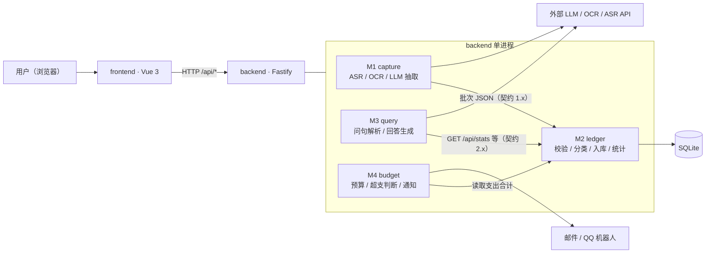

# 架构与方案设计

> 状态：骨架提案（v0）。首个后端 / 前端骨架 PR 合并后，目录与脚本以代码为准，本文同步更新。
> 技术选型理由见 [ADR-0001](decisions/ADR-0001-tech-stack.md)；接口细节见 [契约 v1](contracts/module2-interface-v1.md)。

## 1. 总体结构



关键原则：

- **所有外部 AI API 调用都在服务端完成**并经服务端鉴权；浏览器不持有密钥，不在本地存放隐私数据。
- **M2 是事实的唯一来源**：金额聚合、时间范围换算、分类判断只在 M2 做；M1 只给字段，M3 只负责「说人话」。
- **模块间只通过契约交互**：即使同进程，也通过契约定义的类型与服务函数（或 HTTP 接口）调用，不直接读写对方的表。

## 2. 目录结构（提案）

```text
.
├── AGENTS.md / CLAUDE.md          # 代理规则
├── README.md                      # 交付 README（评审入口）
├── CONTRIBUTING.md                # 协作流程
├── docker-compose.yml
├── pnpm-workspace.yaml
├── .env.example
├── backend/
│   ├── Dockerfile
│   ├── package.json
│   ├── src/
│   │   ├── app.ts                 # Fastify 实例与插件注册
│   │   ├── server.ts              # 启动入口
│   │   ├── config/                # 环境变量读取与校验
│   │   ├── db/
│   │   │   ├── migrations/        # SQL 迁移脚本，按序号命名
│   │   │   └── seed/              # 预设类别与演示数据导入
│   │   ├── shared/                # 跨模块类型、错误码、金额/时间工具
│   │   └── modules/
│   │       ├── capture/           # M1
│   │       ├── ledger/            # M2
│   │       ├── query/             # M3
│   │       ├── budget/            # M4
│   │       ├── gamification/      # 扩展
│   │       └── audit/             # 扩展
│   └── test/                      # 按模块分目录
├── frontend/
│   ├── package.json
│   └── src/{views,components,api,stores}/
├── packages/
│   └── capture-flow/              # M1 确认/重试纯流程，前后端共用的 workspace 包
├── data/
│   └── samples/                   # 演示账单 CSV、示例小票图片（虚构数据）
└── docs/
    ├── GLOSSARY.md  ARCHITECTURE.md  CODING_STANDARDS.md  AI_CODING_POLICY.md
    ├── PROBLEMS_AND_GAPS.md
    ├── contracts/                 # 冻结接口契约
    ├── decisions/                 # ADR
    └── agent-logs/                # 代理日志
```

每个 `modules/<name>/` 内部建议分层：`routes.ts`（HTTP）→ `service.ts`（业务）→ `repository.ts`（SQL），`types.ts` 放对外类型，`index.ts` 只导出供其他模块调用的服务函数。

`@gduf/capture-flow` 只保存字段草稿、组装批次、关联回执和保留安全重试状态；通过依赖注入调用 M2，不依赖 Node、数据库或前端框架。前端引用包的公共入口，后端 `capture/index.ts` 保留兼容导出；识别服务仍放在后端，分类、去重、追问轮次仍由 M2 负责。

## 3. 模块边界

> 人员分工见 [README 团队分工](../README.md#团队分工)；M2 与 M4 由同一组负责，但代码仍按 `ledger/`、`budget/` 两个目录分开。

| 模块 | 负责 | 不负责 | 对外接口 |
|---|---|---|---|
| M1 capture | 语音转写、OCR、字段抽取、组装批次、把 `feedback` 转成话术 | 分类、入库、去重、追问轮次 | 调用 M2 导入接口 |
| M2 ledger | 校验、分类、入库、追问状态机、统计、账单一览、类别管理 | 自然语言解析、话术、UI | `POST /api/transactions/import`、`GET /api/stats`、`GET /api/transactions`、`/api/categories` |
| M3 query | 问句 → 结构化参数；结果 → 回答 | 任何金额聚合、时间换算、分类判断 | 对话接口（待定义，见第 5 节） |
| M4 budget | 预算 CRUD、超支判断、通知 | 账单入库、统计口径 | `GET /api/budgets` 等 |
| frontend | 页面、交互、图表 | 业务计算 | — |

## 4. 数据与口径

- 数据库：SQLite 单文件，容器内路径通过 `DATABASE_PATH` 配置，挂载到卷持久化。
- 金额：入库为整数分；M1 入站的元在 M2 校验阶段转换，转换只发生这一处。
- 时间：存 ISO-8601 字符串（带 `+08:00`）并冗余 `occurred_date` 用于统计；统计时区 `Asia/Shanghai`。
- 预设类别 ID 1–13 固定，由 seed 脚本写入；前端与话术通过 `GET /api/categories` 获取。
- 上传文件（语音/图片）落盘到 `UPLOAD_DIR`，数据库只存相对路径（`sourceRef`）。

## 5. 待定事项

| 事项 | 负责 | 备注 |
|---|---|---|
| 前端 ↔ 后端的对话入口接口（记账与查账是否共用一个 `/api/chat`） | M1 + M3 + 前端 | 定稿后补契约 v1.x |
| M4 预算接口完整定义 | M4 | 契约 2.5 仅定义了读取 |
| 鉴权方式（单用户演示 Token / 简单登录） | M2 + reviewer | **已定**：契约 v1.2 §0.1，单用户 `DEMO_USER_ID` + 可选 `APP_AUTH_TOKEN` |
| LLM / OCR / ASR 服务商 | M1 + M3 | 定后写 ADR |
| 通知渠道（邮件 / QQ 机器人） | M4 | — |
| 游戏化形态（宠物 / 种树） | `mianyoubiaoqing` | 第二周 |
| 异常消费审计规则 | `mianyoubiaoqing` | 需与 M2 约定 `anomalyFlag` 的写入方式 |
